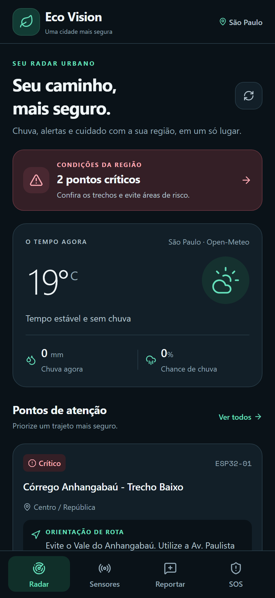
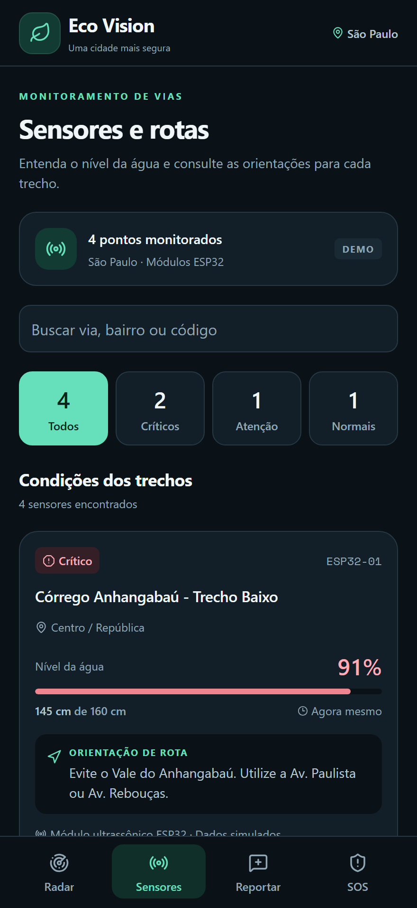
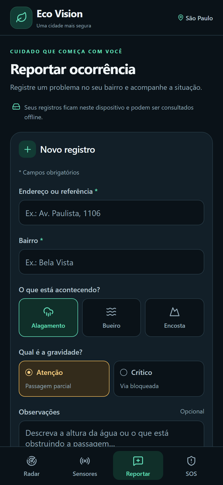
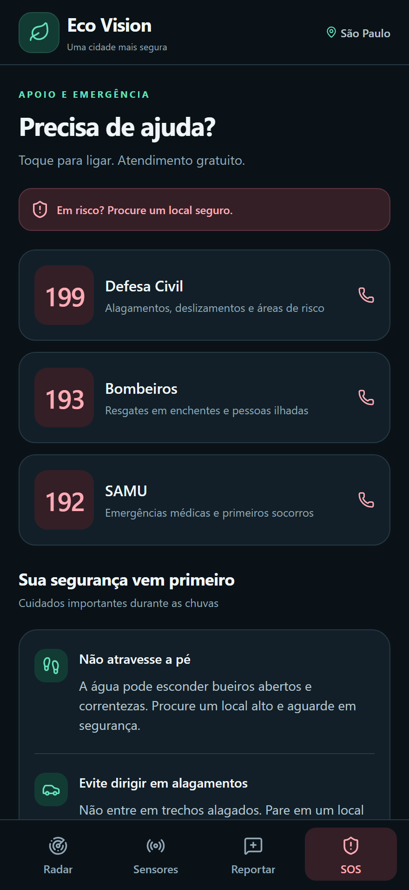
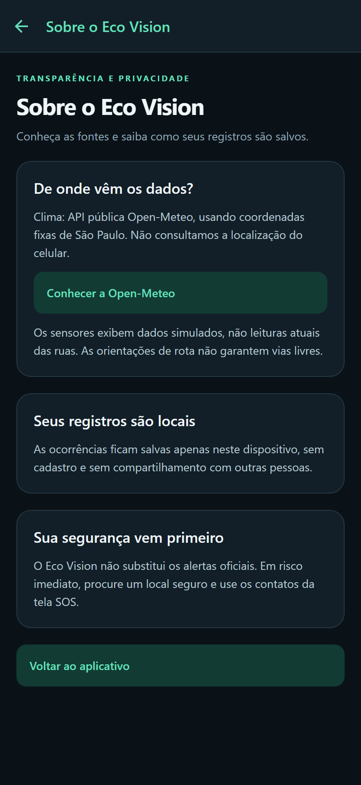

# Eco Vision — Radar urbano e registro de alagamentos

Aplicativo mobile desenvolvido em **React Native, Expo e TypeScript** para a **Global Solution 2026.2 — CitizenTech (FIAP)**, na disciplina de **Mobile Development & IoT**.

O cidadão consulta o clima de São Paulo, visualiza exemplos de pontos de atenção, registra ocorrências e acompanha seu histórico no dispositivo.

> Esta versão usa dados públicos de meteorologia e sensores simulados. Não há conexão com sensores físicos, previsão própria de alagamentos, cálculo de rotas ou compartilhamento de ocorrências entre usuários.

Documentação complementar em [`docs/README.md`](./docs/README.md).

## Equipe

| Integrante | RM |
| --- | --- |
| Gabriel Guilherme Leste | 558638 |
| Gabriel Lacerda | 558307 |
| Fernando Carlos | 558095 |
| Julia Carolina | 558896 |

## Proposta da CitizenTech

- **Nome:** Eco Vision.
- **Região de referência:** São Paulo — SP, com pontos simulados no Centro e em corredores de mobilidade urbana.
- **Público:** moradores, pedestres e motoristas que precisam consultar informações sobre chuvas e registrar problemas nas vias.
- **Problema:** a falta de informações locais sobre alagamentos e obstruções dificulta decisões de deslocamento e o acompanhamento dos problemas do bairro.
- **Objetivo:** reunir informações meteorológicas e registros locais em uma interface simples para celular.

A proposta se relaciona aos **ODS 11** (Cidades e Comunidades Sustentáveis), **13** (Ação Contra a Mudança Global do Clima) e **9** (Indústria, Inovação e Infraestrutura). A redução de riscos e a integração com sensores reais são objetivos da solução, não resultados medidos nesta entrega.

## Funcionalidades

| Tela | O que está implementado |
| --- | --- |
| **Radar** | Consulta à Open-Meteo, destaque dos sensores simulados em estado crítico e contagem de ocorrências locais em aberto. |
| **Sensores** | Lista de quatro sensores simulados, níveis de água em centímetros e percentual, filtros por estado e busca por via, bairro ou código. As orientações de desvio são exemplos fixos. |
| **Reportar** | Cadastro de endereço/referência, bairro, categoria, gravidade e observações; histórico com ações para resolver, reabrir e excluir registros com confirmação. |
| **SOS** | Abre o discador com os números da Defesa Civil (199), Bombeiros (193) e SAMU (192), além de apresentar orientações de segurança. Não aciona esses serviços automaticamente. |
| **Sobre** | Fontes dos dados, armazenamento local e limites das informações. Acesso pelo nome Eco Vision no cabeçalho. |

O clima é consultado na carga inicial do radar e quando o usuário solicita uma atualização; não há monitoramento contínuo em segundo plano. Falhas de consulta são exibidas com opção de tentar novamente. Se uma atualização falhar após uma consulta bem-sucedida, os valores anteriores podem permanecer visíveis com aviso de desatualização.

## Capturas de tela

| Radar | Sensores | Reportar | SOS | Sobre |
| :---: | :---: | :---: | :---: | :---: |
|  |  |  |  |  |

## Vídeo demonstrativo
<a href="https://www.youtube.com/shorts/b-m32nA39_8">Link do vídeo no YouTube</a>
Também disponível abrindo o arquivo [`GSMobileDevelopment2oSemestre2026EcoVision.mp4`](./GSMobileDevelopment2oSemestre2026EcoVision.mp4).

## Tecnologias e organização

- **Expo SDK 58**, **React Native** e **TypeScript**.
- **Expo Router**, com navegação inferior entre as quatro telas principais.
- **Fetch** para consultar a API pública de clima.
- **Expo SQLite** para o banco local no Android/iOS.
- **IndexedDB** para o banco local na versão web.
- **AsyncStorage** somente para ler e migrar registros da versão anterior.
- **Lucide React Native** para os ícones.

```text
src/
  app/                  Rotas e layouts do Expo Router
    (tabs)/             Radar, sensores, registro/histórico e SOS
    modal.tsx           Tela Sobre
  components/           Componentes reutilizáveis e feedback de erro
  hooks/                Carregamento, erro e nova tentativa de dados
  services/             Consulta de clima e mock dos sensores
  storage/              Bancos locais e migração de registros antigos
  theme/                Cores, fontes, espaçamentos e estilos
  types/                Tipos da aplicação
tests/                  Testes automatizados
```

## Fontes dos dados e limites

### Meteorologia

- **Fonte:** [Open-Meteo](https://open-meteo.com/).
- **Endpoint:** `https://api.open-meteo.com/v1/forecast`.
- **Dados utilizados:** temperatura, precipitação e probabilidade de chuva.
- **Localização:** coordenadas públicas fixas de São Paulo (`-23.5614, -46.6559`). O app não solicita a localização do celular.
- **Licença dos dados:** CC BY 4.0, com atribuição na interface e neste README.
- **Acesso:** API gratuita para uso não comercial, dentro de seus limites de utilização, sem chave ou cadastro. A atualização do clima depende de internet.

### Sensores e orientações de rota

Os dados de `src/services/iotSensors.ts` são **simulados**, incluindo níveis, estados, horários de atualização e orientações de desvio. Há uma latência artificial de 400 ms para representar uma consulta.

O app não recebe telemetria de ESP32, não verifica o trânsito e não garante que uma via esteja livre. As informações não substituem alertas ou instruções das autoridades.

### Ocorrências e privacidade

- Os registros ficam apenas no dispositivo; não são publicados nem enviados a um servidor.
- O app não exige cadastro nem possui campos específicos para nome, telefone ou documentos.
- Para a demonstração, utilize informações fictícias ou públicas. Não insira dados pessoais nos campos de texto.
- A solução não depende de backend, conta em serviço de nuvem, assinatura ou plano pago.

## Persistência e funcionamento offline

No **Android/iOS**, os registros ficam no arquivo SQLite `eco-vision.db`, na tabela `citizen_reports`. No **navegador**, ficam no IndexedDB `eco-vision`.

Uma instalação nova começa sem ocorrências. Registros existentes da versão anterior são migrados do AsyncStorage, preservando o armazenamento original. A migração é marcada para não repetir a importação após exclusões.

Com o app já carregado, o usuário pode consultar os sensores simulados e criar, consultar, resolver, reabrir ou excluir ocorrências sem internet. O carregamento do projeto no Expo Go durante o desenvolvimento ainda depende de acesso ao servidor Expo.

Não há sincronização entre celulares nem entre o celular e o navegador. Limpar os dados do aplicativo/navegador ou desinstalar o app pode apagar os registros locais.

## Tema e acessibilidade

- Cores centralizadas em `src/theme/colors.ts`.
- Fontes, espaçamentos e estilos centralizados em `src/theme/styles.ts`.
- Texto com escalonamento de fonte do sistema e campos de formulário com fonte de 16.
- Estados de risco identificados por **cor, ícone e texto**, não apenas por cor.
- Rótulos acessíveis em campos e ações, foco no campo obrigatório durante a validação e valores acessíveis nas barras de nível.
- Botões principais com áreas de toque de pelo menos 44 pontos.

Esses cuidados não representam uma certificação de acessibilidade. A conferência com fonte ampliada, TalkBack e VoiceOver deve ser feita no dispositivo.

## Como executar

### Pré-requisitos

- **Node.js 22.13+ na linha 22 ou 24.3+ na linha 24**, compatíveis com o SDK utilizado.
- **npm**.
- **Expo Go compatível com o SDK 58** no celular, ou navegador para a versão web.

```bash
git clone https://github.com/Manerrando28/econ-vision.git
cd econ-vision
npm ci
npx expo start --clear
```

Abra o projeto no Expo Go pelo QR Code, mantendo celular e computador com acesso ao servidor Expo. Para a versão web, pressione `w` no terminal ou execute:

```bash
npm run web
```

Reinicie o servidor Expo após instalar dependências ou alterar a estrutura das rotas.

## Verificações

```bash
npm run lint
npm run typecheck
npm test
npx expo-doctor
```

Os sete testes automatizados verificam:

- CRUD em SQLite e recuperação por outra instância do repositório;
- migração de registros antigos sem reimportar ocorrências excluídas;
- erro em dados antigos inválidos;
- rejeição de cadastro sem endereço;
- uso do horário retornado pela API de São Paulo;
- erros de rede, HTTP e resposta incompleta, sem inventar medições;
- ausência de literais de cores, fontes e espaçamentos fora do tema em `src/`.

Os testes usam SQLite real em memória no Node, com uma ponte de teste no lugar da API nativa do Expo. Não substituem testes de execução e persistência após fechar/reabrir o app no Expo Go ou emulador.

Para exportar os bundles:

```bash
npx expo export --platform all --max-workers 2
```

A exportação gera arquivos em `dist/`; não gera um APK/IPA instalável nem comprova, por si só, a execução no celular.

## Roteiro de uso para demonstração

1. Navegue entre Radar, Sensores, Reportar e SOS.
2. Em **Sensores**, busque `Anhangabau`, combine a busca com os filtros e procure um texto inexistente para conferir a lista vazia.
3. Em **Reportar**, tente salvar sem preencher os campos obrigatórios. Depois, cadastre uma ocorrência fictícia.
4. Feche e reabra o app para conferir a recuperação do registro. Marque-o como resolvido, reabra e exclua com confirmação.
5. Atualize o radar sem internet para conferir o erro de clima. Reconecte e use **Tentar novamente**. Os dados locais continuam disponíveis com o app carregado.
6. Confira teclado, fonte ampliada, leitor de tela e áreas seguras no dispositivo. Não faça ligações reais de emergência durante a demonstração.

## Agradecimentos

Agradecemos à FIAP e ao professor de Mobile Development & IoT pelas orientações e pela proposta de aplicar tecnologia a problemas reais da cidade.
